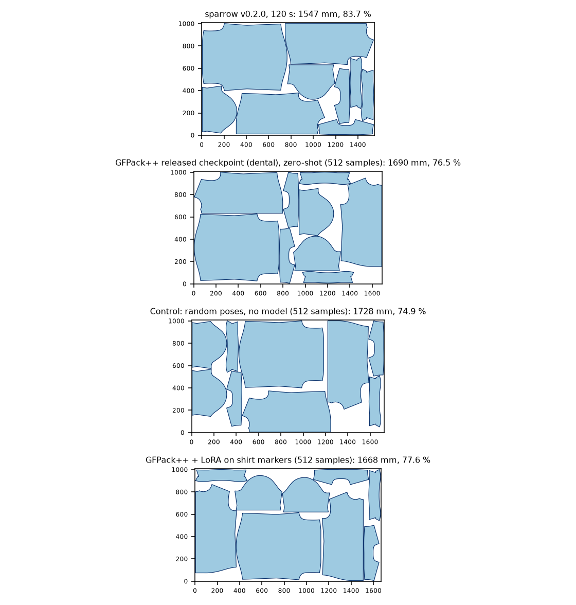

# GFPack++ against sparrow, 1007 mm roll

Research benchmark on one shirt pattern (six shapes, nine copies). It adds GFPack++ to the open-source comparison in [benchmark.md](benchmark.md): same polygons, same rules, same evaluator (`bench/evaluate.py`). **sparrow was not run again**: its rows are the stored records of that comparison. It says nothing about other garments or production markers.

Generated by `python -m bench.gfpack_report`; no number below is typed by hand.

## What GFPack++ is, and what had to be added

GFPack++ (Xue et al., ICCV 2025; code `TimHsue/GFPack-pp` at `ff75815`) is a learned packer: a score model turns noise into poses (x, y, cos, sin) of the pieces by reverse diffusion. The released checkpoint (`dental.pth (Google Drive archive linked in the GFPack-pp README)`) was trained on 440 dental polygons, 48 per puzzle, in a 1205-unit strip. It is conditioned on the polygons only: no roll width, no gap, no grain rule. Its own post-processing slides pieces left and down while they do not overlap and does not remove overlaps, and its rotations are continuous.

So the pipeline here wraps the model (`bench/gfpack_infer.py`, CPU, in WSL):

1. every polygon is grown by gap/2 + 0.1 mm, centred on its vertex mean and scaled so the usable roll width (1002.2 mm) becomes the 1205 units the model knows;
2. the sampler draws N layouts (128 reverse-diffusion steps, the repository default);
3. each layout is snapped to the allowed rotations 0/90/180/270, made overlap-free by a deterministic push-out that keeps every polygon inside the roll, and compacted with GFPack++'s own `rm_spacing_all`;
4. the 40 shortest layouts go through the shared evaluator; the best valid one is the result.

Step 3 is not part of GFPack++. It is why the **control** row exists: the same steps with uniformly random poses instead of the model. The difference between the two rows is what the model contributes.

## Setup

- Roll 1007 mm, gap 5 mm to neighbours and 5 mm to the selvedges; 9 copies, cut-line area 1.3031 m2, so no marker is shorter than 1317 mm.
- Grain rule of the sparrow records: every grain line along or across the roll (rotations 0/90/180/270), mirrored pairs. Same evaluator and rule for every row.
- GFPack++ ran on CPU only (Intel Core Ultra 5 228V, 8 threads, in WSL). The paper reports GPU inference; that was not available here, so the wall times below are CPU times and are not the paper's speed.
- Three runs (seeds 0-2) per row show the spread, not a statistical test.

## Results

| nester | samples x steps | runs (valid) | best mm | median mm | worst mm | median efficiency | min gap mm | median wall time |
|---|---|---|---|---|---|---|---|---|
| sparrow v0.2.0, 30 s budget (3 workers) | - | 3 (3) | 1547 | 1547 | 1567 | 83.6 % | 5.51 | 30 s |
| sparrow v0.2.0, 120 s budget (3 workers) | - | 3 (3) | 1547 | 1547 | 1547 | 83.7 % | 5.26 | 120 s |
| sparrow v0.2.0, 300 s budget (3 workers) | - | 1 (1) | 1547 | 1547 | 1547 | 83.7 % | 5.28 | 300 s |
| This study, 30 s budget | - | 3 (3) | 1603 | 1618 | 1633 | 80.0 % | 5.30 | 30 s |
| This study, 120 s budget | - | 3 (3) | 1584 | 1585 | 1601 | 81.6 % | 5.29 | 120 s |
| GFPack++ released checkpoint (dental), zero-shot | 512 x 128 | 3 (3) | 1690 | 1695 | 1725 | 76.3 % | 5.45 | 325 s |
| Control: random poses, no model | 512 x 128 | 3 (3) | 1728 | 1745 | 1746 | 74.2 % | 5.47 | 92 s |
| GFPack++ + LoRA on shirt markers | 512 x 128 | 3 (3) | 1668 | 1711 | 1741 | 75.6 % | 5.44 | 292 s |

Wall time of a GFPack++ row = model start, sampling, legalisation and compaction of all samples (WSL start-up included); the evaluator is not counted. sparrow and this study plan their search around a time budget; GFPack++ has none, so its cost is set by the number of samples.

## Findings

- **GFPack++ released checkpoint (dental), zero-shot** (512 x 128): median 1695 mm, +148 mm (+9.6 %) against sparrow at 120 s (1547 mm); area lower bound 1317 mm.
- **Control: random poses, no model** (512 x 128): median 1745 mm, +198 mm (+12.8 %) against sparrow at 120 s (1547 mm); area lower bound 1317 mm.
- **GFPack++ + LoRA on shirt markers** (512 x 128): median 1711 mm, +164 mm (+10.6 %) against sparrow at 120 s (1547 mm); area lower bound 1317 mm.
- Model against control: the released checkpoint makes the marker 50 mm (2.9 %) shorter than random poses through the same legaliser.
- LoRA against zero-shot: -16 mm (-0.9 %) in median length.

## What the model itself produces

Before legalisation, a layout drawn by the sampler overlaps itself: the median total overlap over the samples of a run, the share of layouts the push-out could make feasible, and the length quantiles of the feasible layouts (compaction included, evaluator margins excluded).

| row | samples | median raw overlap | feasible layouts | shortest | 10 % quantile | median |
|---|---|---|---|---|---|---|
| GFPack++ released checkpoint (dental), zero-shot | 512 | 0.31 m2 | 75% | 1695 mm | 1849 mm | 2065 mm |
| Control: random poses, no model | 512 | 0.29 m2 | 87% | 1746 mm | 2020 mm | 2247 mm |
| GFPack++ + LoRA on shirt markers | 512 | 0.07 m2 | 68% | 1711 mm | 1865 mm | 2016 mm |

## LoRA fine-tuning

- Teacher: 240 markers made by this study's own nester (`bench/gfpack_teacher.py`, 20 s each, 4 rotations, mirrored pairs) on shirt variants graded by +-15 % per axis; efficiency 75.3-83.7 %. Variants within 3 % of the benchmark size are excluded, so the benchmark instance itself is not in the training set (neighbouring sizes of the same shirt are). sparrow results are not used.
- Method (`bench/gfpack_lora.py`): rank 16 low-rank deltas on every attention and feed-forward weight of the transformer and on the output layer (base weights and geometry encoder frozen), the original denoising score-matching loss, 2000 steps, batch 48, learning rate 0.001 with cosine decay, point reflection of whole markers as augmentation, 20 markers held out for validation. Deltas are merged back into a plain state dict.
- Validation loss 18.76 before and 3.86 after training.

Reading the two tables together: the adapted model produces layouts that overlap much less before legalisation and whose feasible layouts are shorter on average, but the shortest of 512 layouts did not improve. The shortest layouts of the released model come from its wide, noisy distribution; the adapted one is narrower. With three runs this is a pattern to check, not a result.

## Best markers

## Caveats

- The comparison is a pipeline (model + legaliser + compaction) against sparrow, not the model alone: the released GFPack++ output is not feasible on this problem without step 3.
- The released checkpoint is dental; the LoRA rows learn from markers made by this study's own nester on graded variants of the same shirt (see "LoRA fine-tuning"), so they show adaptation to this garment family, not generalisation to other garments.
- CPU only; GPU times from the paper are not reproduced.
- The sampler runs with dropout off (`model.eval()`); the repository's evaluation script leaves it on. The effect was not measured.
- GFPack++ has no time budget, so sparrow's 30/120/300 s rows and the sample-count rows are not equal-time pairs.
