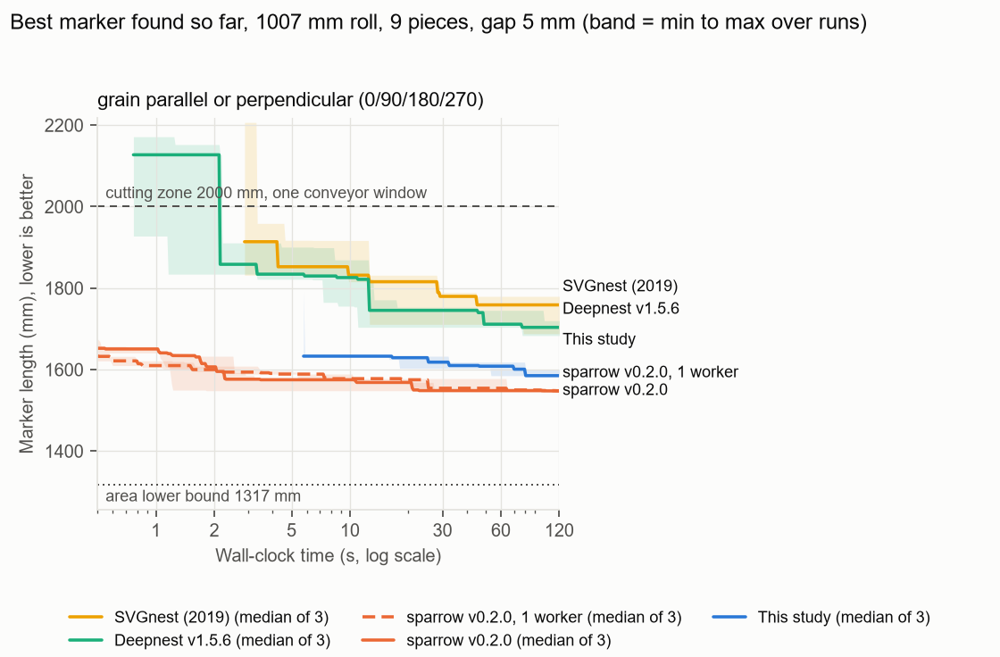
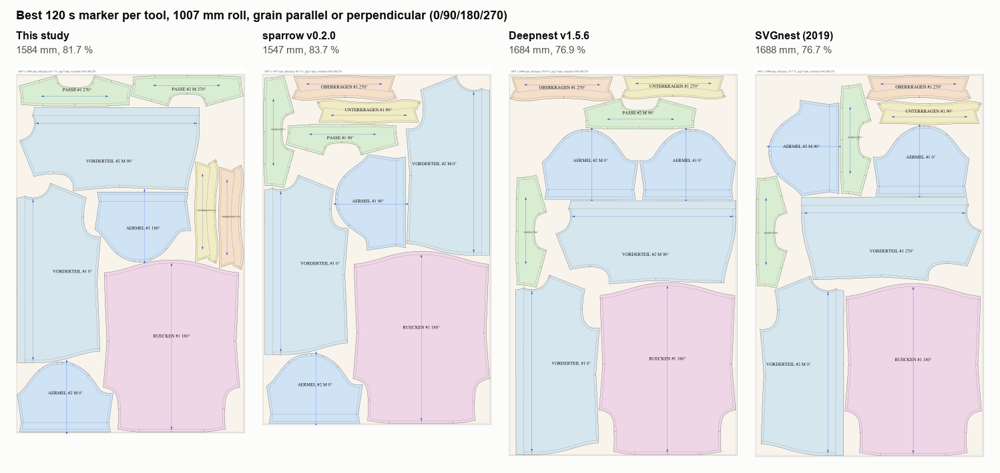

# Open-source nesting comparison, 1007 mm roll

Research benchmark for one shirt pattern (six shapes, nine copies) on one roll width. It compares this
study's nester with three open-source nesters on exactly the same polygons, checked by one evaluator.
It says nothing about other garments or production markers.

The markers are for ITA's Bullmer PremiumCut 1620 CV (offer 0912241527), which takes rolls up to 1600 mm
wide and cuts a 2000 mm zone on a conveyor, so a longer marker is cut in several conveyor windows. The
roll here is 1007 mm wide, the plot width of the pattern PDF.

Generated by `python -m bench.compare report` from the run records in `out/bench/runs/`; no
number below is typed by hand. Machine: Intel(R) Core(TM) Ultra 5 228V, 8 cores / 8 threads.

## Setup

- Roll 1007 mm wide, gap 5 mm between cut lines and 5 mm to the selvedges.
- 9 copies with a total cut-line area of 1.3031 m2, so no marker can be shorter than 1317 mm.
- Cutting zone 2000 mm: a marker up to 2000 mm long, margins included, is cut in one conveyor window.
- Copy 2 of every 2x piece is mirrored before nesting (single-ply left and right). The external tools cannot
  mirror, so every tool receives the same pre-mirrored polygons, and this study runs with `--mirror pairs`.
- Each tool packs the cut line simplified with 0.25 mm tolerance and grown back by 0.25 mm, so the packed
  polygon always contains the true cut line. The evaluation uses the true cut lines only.
- Grain rule: every grain line (FDL) along or across the roll, never tilted: rotations
  0/90/180/270, the rule set for this study on 2026-10-01. 90/270 cut a piece cross-grain;
  `--rules 2rot` keeps every grain line along the roll.
- One evaluator for every tool (`bench/evaluate.py`): all nine copies exactly once, allowed rotations only,
  pairwise distance of at least 5 mm minus 0.1 mm, fit across the roll. Length is the extent
  along the roll plus both margins.
- Runs execute one at a time on the same machine. Times are wall-clock from the moment a tool has the instance.

| nester | version | settings used |
|---|---|---|
| This study | this study (nesting/) | single copies (no pre-nested pairs), beam 16, window 4, iterated local search with restarts until the time limit, seeds 0-2, one thread |
| sparrow | sparrow v0.2.0 (ed1c72c) | `--min-item-separation 5`, allowed orientations per rule, seeds 0-2, default 3 separator workers, also 1 worker |
| Deepnest | Deepnest v1.5.6 (deepnest-next release) | spacing 5 mm, placement `gravity`, merge lines off, rotations 4, population 10, mutation 10 |
| SVGnest | SVGnest 1248dc2 (2019, last commit) | spacing 5 mm, rotations 4, population 10, mutation 10, curve tolerance 0.05 mm |

## Results: grain parallel or perpendicular (0/90/180/270)

| nester | budget | runs (valid) | best mm | median mm | worst mm | median efficiency | min gap mm | fits one 2000 mm zone | threads | evaluations/s |
|---|---|---|---|---|---|---|---|---|---|---|
| This study | 30 s | 3 (3) | 1603 | 1618 | 1633 | 80.0 % | 5.30 | 3 of 3 | 1 | - |
| This study | 120 s | 3 (3) | 1584 | 1585 | 1601 | 81.6 % | 5.29 | 3 of 3 | 1 | - |
| sparrow v0.2.0 | 30 s | 3 (3) | 1547 | 1547 | 1567 | 83.6 % | 5.51 | 3 of 3 | 3 | - |
| sparrow v0.2.0 | 120 s | 3 (3) | 1547 | 1547 | 1547 | 83.7 % | 5.26 | 3 of 3 | 3 | - |
| sparrow v0.2.0 | 300 s | 1 (1) | 1547 | 1547 | 1547 | 83.7 % | 5.28 | 1 of 1 | 3 | - |
| sparrow v0.2.0, 1 worker | 120 s | 3 (3) | 1547 | 1547 | 1547 | 83.6 % | 5.50 | 3 of 3 | 1 | - |
| Deepnest v1.5.6 | 30 s * | 3 (3) | 1704 | 1745 | 1753 | 74.1 % | 5.48 | 3 of 3 | 1 | 4.39 |
| Deepnest v1.5.6 | 120 s | 3 (3) | 1684 | 1704 | 1720 | 76.0 % | 5.48 | 3 of 3 | 1 | 4.39 |
| SVGnest (2019) | 30 s * | 3 (3) | 1711 | 1780 | 1790 | 72.7 % | 5.33 | 3 of 3 | 8 | 0.51 |
| SVGnest (2019) | 120 s | 3 (3) | 1688 | 1759 | 1780 | 73.6 % | 5.22 | 3 of 3 | 8 | 0.51 |

`*` Deepnest and SVGnest have no time budget of their own. Their 30 s row is the best marker of each 120 s
run at 30 s, re-evaluated from the stored placements. sparrow and this study plan their search around the
budget, so they ran separately at 30 s and at 120 s.

## Findings

- **grain parallel or perpendicular (0/90/180/270), 30 s**, median length in mm: sparrow v0.2.0 1547 < This study 1618 < Deepnest v1.5.6 1745 < SVGnest (2019) 1780. This study is 71 mm (4.6 %) longer than sparrow v0.2.0.
- **grain parallel or perpendicular (0/90/180/270), 120 s**, median length in mm: sparrow v0.2.0 1547 < This study 1585 < Deepnest v1.5.6 1704 < SVGnest (2019) 1759. This study is 38 mm (2.5 %) longer than sparrow v0.2.0.
- **grain parallel or perpendicular (0/90/180/270), reference**: sparrow given 300 s reached 1547 mm (83.7 %). The area lower bound is 1317 mm.
- **grain parallel or perpendicular (0/90/180/270), cutting zone**: every valid marker fits one 2000 mm conveyor window; the longest is 1790 mm, 210 mm inside the zone.

## Convergence



sparrow's curve uses the strip widths it logs. They are measured on the packed polygons and sit up to 1 mm
above the evaluated length. The other curves are evaluated lengths.

## Best markers



## The same shirt on both rolls

Median 120 s marker of each setup. Fabric per shirt is roll width times marker length: what one
shirt takes off the roll when it is cut on its own.

**grain parallel or perpendicular (0/90/180/270)**

| nester | 1007 mm roll: median mm | fabric m2 | 1600 mm roll: median mm | fabric m2 |
|---|---|---|---|---|
| This study | 1585 | 1.60 | 1016 | 1.63 |
| sparrow v0.2.0 | 1547 | 1.56 | 977 | 1.56 |
| Deepnest v1.5.6 | 1704 | 1.72 | 1085 | 1.74 |
| SVGnest (2019) | 1759 | 1.77 | 1127 | 1.80 |

Least fabric per shirt: 1007 mm roll 1.56 m2 (sparrow v0.2.0), 1600 mm roll 1.56 m2 (sparrow v0.2.0).

## Caveats

- Three runs per setting show the spread, not a statistical test.
- The runs used a laptop with other applications open. Wall-clock times include whatever else the
  machine was doing, which affects every tool alike only on average.
- This study's beam search is deterministic, so its duration gauges the machine during the runs: grain parallel or perpendicular 8.6-9.8 s.
- Threads differ. This study and Deepnest use one worker, sparrow uses three separator workers by default
  (the 1-worker rows isolate that), and SVGnest spreads its no-fit-polygon work over web workers.
- Deepnest 1.5.6 evaluates one individual at a time whatever `threads` says, and it does not shrink the
  sheet by half the spacing. The sheet is therefore given as roll width minus the gap.
- SVGnest and Deepnest were set up for strip packing (gravity placement, no merged cut lines). Their
  defaults target sheet nesting and laser cutting time and would score worse on this objective.

## Reproduce

```powershell
.\.venv\Scripts\python -m pip install -r bench\requirements.txt
.\.venv\Scripts\python -m bench.fetch_tools
.\.venv\Scripts\python -m nesting import examples\schnittteile-hemd.pdf -o out\pieces.json
.\.venv\Scripts\python -m bench.compare run
.\.venv\Scripts\python -m bench.compare report
```

`bench.fetch_tools` pins SVGnest to its last commit, downloads the Deepnest 1.5.6 Windows release (SHA-256
checked) and builds sparrow v0.2.0 with a Rust toolchain installed under `.bench/rust`. Chrome runs SVGnest
headless. Deepnest opens its own window while it works.
